# 6. Тестовый контур и безопасное влитие

Актуально на 20.07.2026.

## Состояние внедрения

Готово:

- ветка `develop` опубликована в GitVerse;
- отдельный worktree `/opt/aspectcoffee-test` связан с `develop`;
- запущены изолированные контейнеры web, worker и Redis;
- создана независимая копия DB/media, удалены OAuth-секреты и push-подписки;
- реальные payment/deploy webhook и автоматический парсер отключены;
- HAProxy подготовлен к маршрутизации SNI `test.aspectcoffee.ru`;
- 21 из 21 Django-тестов проходит успешно.

До ввода домена в эксплуатацию остаётся:

1. Добавить DNS `A`: `test.aspectcoffee.ru → 45.155.52.48`, TTL 3600.
2. После распространения DNS выпустить Let's Encrypt-сертификат.
3. Запустить test Nginx на `10.88.0.1:8444` и проверить внешний HTTPS.
4. После приёмочных тестов согласовать Pull Request `develop → main`.

До выполнения пунктов 1–3 тестовый backend работает только внутри сервера и не
считается опубликованным внешним тестовым сайтом.

## Модель

```mermaid
flowchart LR
    F["feature/* или fix/*"] -->|"Pull Request + review"| D["develop"]
    D -->|"автодеплой/ручной deploy"| T["test.aspectcoffee.ru"]
    T -->|"приёмочные тесты пройдены"| PR["Pull Request develop → main"]
    PR -->|"review + обязательные проверки"| M["main"]
    M -->|"контролируемый deploy"| P["aspectcoffee.ru"]
    P -->|"неизменяемая метка"| R["release/YYYY-MM-DD"]
```



`develop` является единственным источником тестового контура, а `main` —
единственным источником production. Прямые push в обе ветки запрещаются защитой
веток GitVerse. В `main` попадает ровно тот коммит, который прошёл проверку на
`test.aspectcoffee.ru`.

## Изоляция

Тестовый контур размещён в `/opt/aspectcoffee-test` и запускается отдельным
Compose-проектом `aspectcoffee-test`:

- отдельные контейнеры web, worker, Redis и Nginx;
- отдельные `runtime/db.sqlite3`, `runtime/media/`, `runtime/staticfiles/`;
- отдельные Django/JWT secrets и cookie names;
- письма выводятся только в логи worker/web;
- production-реквизиты ЮKassa, СДЭК, OAuth и Web Push не копируются;
- payment/deploy webhook на тестовом Nginx возвращают 404;
- поисковая индексация запрещена через `X-Robots-Tag` и `robots.txt`;
- внешний доступ ограничивается правилами HAProxy;
- разрешённый IP попадает на тестовый сайт, остальные запросы к тестовому
  hostname получают `503 Service Unavailable`. Это даёт понятный HTTP-ответ,
  одновременно не открывая приложение посторонним.

Версионируемый шаблон маршрутизации находится в
`deploy/haproxy/haproxy.cfg`; рабочий файл сервера —
`/etc/haproxy/haproxy.cfg`.

Как добавить IP и полностью открыть сайты с сохранением VPN:
[пошаговая инструкция](10_IP_ACCESS_CONTROL.md).

## Первичное развёртывание

```bash
cd /opt/aspectcoffee-test
cp .env.test.example .env.test
# Сгенерировать и заполнить SECRET_KEY/JWT_SECRET_KEY
mkdir -p runtime/media runtime/staticfiles
touch runtime/db.sqlite3
docker compose -f docker-compose.test.yml build web
docker compose -f docker-compose.test.yml run --rm web python manage.py migrate
docker compose -f docker-compose.test.yml run --rm web python manage.py prepare_test_environment
docker compose -f docker-compose.test.yml run --rm web python manage.py collectstatic --noinput
docker compose -f docker-compose.test.yml up -d
```

## Обновление теста

```bash
cd /opt/aspectcoffee-test
git fetch origin
git switch develop
git pull --ff-only origin develop
docker compose -f docker-compose.test.yml build web
docker compose -f docker-compose.test.yml run --rm web python manage.py migrate --plan
docker compose -f docker-compose.test.yml run --rm web python manage.py migrate
docker compose -f docker-compose.test.yml run --rm web python manage.py prepare_test_environment
docker compose -f docker-compose.test.yml run --rm web python manage.py collectstatic --noinput
docker compose -f docker-compose.test.yml up -d --remove-orphans
docker compose -f docker-compose.test.yml exec -T web python manage.py check
```

Перед каждым обновлением копируются `runtime/db.sqlite3` и `runtime/media/`.
Production при этом не перезапускается.

## Перенос в production

1. Зафиксировать проверенный SHA ветки `develop`.
2. Создать Pull Request `develop → main`.
3. Запустить тесты и проверить отсутствие секретов/миграционных конфликтов.
4. Получить review и запретить merge при красных проверках.
5. После merge создать резервную копию production DB/media.
6. Развернуть точный SHA из `main`, выполнить миграции и smoke-тест.
7. Создать тег или ветку `release/YYYY-MM-DD` для быстрого отката.

Срочные исправления идут через `hotfix/* → develop → test → main`. Обход
тестового домена допускается только при подтверждённой аварии и всё равно требует
автоматических тестов и резервной копии.
