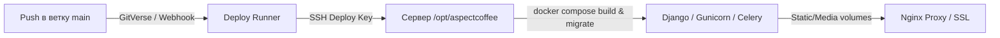

# 7. Деплой на новый сервер под панелью ISPmanager 6

Актуально на 06.08.2026.

## Назначение документа

Данный документ содержит точный регламент передачи продакшн-репозитория и пошаговую инструкцию по развёртыванию приложения **Aspect Coffee** (`aspectcoffee.ru` на **Django 5.2 + Docker Compose**) на новом VDS/VPS сервере под управлением панели **ISPmanager 6**.

---

## 1. Поднятие сервера с панелью ISPmanager

### 1.1 Системные требования

| Параметр | Минимальное значение | Рекомендуемое значение |
|---|---|---|
| **Операционная система** | Ubuntu 22.04 LTS (x86_64) | Ubuntu 22.04 LTS (x86_64) |
| **Процессор (CPU)** | 2 ядра | 4 ядра |
| **Оперативная память (RAM)** | 2 ГБ | 4 ГБ |
| **Диск (NVMe/SSD)** | 30 ГБ | 50+ ГБ |
| **Сетевые порты** | 80 (HTTP), 443 (HTTPS), 22 (SSH), 1500 (ISPmanager) | 80, 443, 22, 1500 |

### 1.2 Установка панели ISPmanager 6

1. Подключитесь к серверу по SSH под пользователем `root`:
   ```bash
   ssh root@<IP_НОВОГО_СЕРВЕРА>
   ```

2. Запустите официальный инсталлятор ISPmanager:
   ```bash
   wget https://download.ispmanager.com/install.sh -O install.sh
   sh install.sh --ispmanager-lite
   ```

3. Перейдите в веб-панель по адресу:
   ```text
   https://<IP_НОВОГО_СЕРВЕРА>:1500/ispmgr
   ```

4. Войдите под `root` и активируйте лицензию ISPmanager.

---

## 2. Настройка окружения сервера и зависимостей

### 2.1 Установка Docker & Docker Compose

Подключитесь по SSH и установите Docker Engine и плагин Docker Compose:

```bash
# Установка Docker
curl -fsSL https://get.docker.com | sh
apt-get install -y docker-compose-plugin git curl

# Проверка версий
docker --version
docker compose version
```

### 2.2 Создание домена и SSL в ISPmanager

1. В ISPmanager перейдите в **Сайты → Создать сайт**:
   - Доменное имя: `aspectcoffee.ru`
   - Корневая директория: `/opt/aspectcoffee`
2. В разделе **SSL-сертификаты** включите бесплатный сертификат **Let's Encrypt** и автоперенаправление HTTP → HTTPS.

### 2.3 Переменные окружения (`.env.prod`)

В директории `/opt/aspectcoffee` скопируйте шаблон и заполните реальные секреты:

```bash
cp .env.example .env.prod
nano .env.prod
```

Обязательные параметры в `.env.prod`:
```env
DEBUG=False
SECRET_KEY=<ДЛИННЫЙ_СЛУЧАЙНЫЙ_КЛЮЧ>
ALLOWED_HOSTS=aspectcoffee.ru,www.aspectcoffee.ru,10.88.0.1

# База данных SQLite (по умолчанию)
DATABASE_URL=sqlite:////app/data/db.sqlite3

# Интеграции
YOOKASSA_SHOP_ID=<ID_МАГАЗИНА>
YOOKASSA_SECRET_KEY=<СЕКРЕТНЫЙ_КЛЮЧ>
CDEK_CLIENT_ID=<CDEK_ID>
CDEK_CLIENT_SECRET=<CDEK_SECRET>
CDEK_TEST_MODE=false
```

---

## 3. Конфигурация репозитория и деплоя (Docker Compose)

### 3.1 Схема автоматического развёртывания



### 3.2 Клонирование репозитория

1. Сгенерируйте SSH Deploy Key на новом сервере:
   ```bash
   ssh-keygen -t ed25519 -C "deploy@aspectcoffee.ru" -f /root/.ssh/id_ed25519_deploy -N ""
   cat /root/.ssh/id_ed25519_deploy.pub
   ```
2. Добавьте публичный ключ в GitVerse/GitHub в **Settings → Deploy keys** (с правом чтения).

3. Клонируйте репозиторий в `/opt/aspectcoffee`:
   ```bash
   cd /opt
   git clone git@gitverse.ru:svpromo/AspectCoffee.git aspectcoffee
   cd aspectcoffee
   ```

### 3.3 Сборка и запуск контейнеров Docker Compose

Приложение состоит из 5 сервисов (`web`, `celery`, `celery-beat`, `redis`, `nginx`):

```bash
cd /opt/aspectcoffee

# 1. Сборка Docker-образов
docker compose build

# 2. Выполнение миграций базы данных
docker compose run --rm web python manage.py migrate

# 3. Сбор статических файлов
docker compose run --rm web python manage.py collectstatic --noinput

# 4. Запуск всех сервисов в фоновом режиме
docker compose up -d

# 5. Проверка статуса процессов
docker compose ps
```

---

## 4. Настройка Nginx Reverse Proxy в ISPmanager

В ISPmanager перейдите в **Сайты → aspectcoffee.ru → Конфигурация Nginx** и настройте проксирование на Docker Nginx/Web:

```nginx
location / {
    proxy_pass http://127.0.0.1:8000;
    proxy_http_version 1.1;
    proxy_set_header Upgrade $http_upgrade;
    proxy_set_header Connection 'upgrade';
    proxy_set_header Host $host;
    proxy_set_header X-Real-IP $remote_addr;
    proxy_set_header X-Forwarded-For $proxy_add_x_forwarded_for;
    proxy_set_header X-Forwarded-Proto $scheme;
}

location /static/ {
    alias /opt/aspectcoffee/staticfiles/;
    expires 30d;
    add_header Cache-Control "public, no-transform";
}

location /media/ {
    alias /opt/aspectcoffee/media/;
    expires 7d;
    add_header Cache-Control "public, no-transform";
}
```

---

## 5. Скрипт автоматического обновления (Deploy Script)

Для обновления сайта создайте скрипт `/opt/aspectcoffee/deploy.sh`:

```bash
#!/bin/bash
set -e
cd /opt/aspectcoffee
git pull origin main
docker compose build web
docker compose run --rm web python manage.py migrate
docker compose run --rm web python manage.py collectstatic --noinput
docker compose up -d
docker compose ps
```

Сделайте его исполняемым:
```bash
chmod +x /opt/aspectcoffee/deploy.sh
```

---

## 6. Контрольный чек-лист ввода в эксплуатацию

- [ ] Сервер доступен по HTTPS (`https://aspectcoffee.ru`).
- [ ] Все контейнеры (`web`, `celery`, `celery-beat`, `redis`, `nginx`) имеют статус `running` (`docker compose ps`).
- [ ] База данных `db.sqlite3` и статика `/static/` отображаются корректно.
- [ ] Команда `docker compose exec -T web python manage.py check --deploy` проходит без критических ошибок.
- [ ] Оплаченная интеграция ЮKassa и СДЭК функционируют в боевом режиме.
