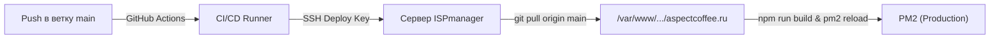

# 7. Деплой на новый сервер под панелью ISPmanager 6

Актуально на 06.08.2026.

## Назначение документа

Данный документ содержит регламент передачи продакшн-репозитория и пошаговую инструкцию по развёртыванию приложения **Aspect Coffee** (`aspectcoffee.ru`) на новом VDS/VPS сервере под управлением панели **ISPmanager 6**.

---

## 1. Поднятие сервера с панелью ISPmanager

### 1.1 Системные требования

| Параметр | Минимальное значение | Рекомендуемое значение |
|---|---|---|
| **Операционная система** | Ubuntu 22.04 LTS (x86_64) | Ubuntu 22.04 LTS (x86_64) |
| **Процессор (CPU)** | 2 ядра | 4 ядра |
| **Оперативная память (RAM)** | 2 ГБ | 4 ГБ |
| **Диск (NVMe/SSD)** | 30 ГБ | 50+ ГБ |
| **Сетевые порты** | 80 (HTTP), 443 (HTTPS), 22 (SSH), 1500 (ISPmanager) | 80, 443, 22, 1500 |

### 1.2 Установка панели ISPmanager 6

1. Подключитесь к серверу по SSH под пользователем `root`:
   ```bash
   ssh root@<IP_НОВОГО_СЕРВЕРА>
   ```

2. Запустите официальный инсталлятор ISPmanager:
   ```bash
   wget https://download.ispmanager.com/install.sh -O install.sh
   sh install.sh --ispmanager-lite
   ```

3. После завершения откройте веб-панель по адресу:
   ```text
   https://<IP_НОВОГО_СЕРВЕРА>:1500/ispmgr
   ```

4. Войдите под `root` и активируйте лицензию ISPmanager.

---

## 2. Настройка окружения сервера

### 2.1 Создание пользователя и веб-сайта

1. В ISPmanager перейдите в **Пользователи → Создать пользователя**:
   - Логин: `aspect_user`
   - Права: Стандартный пользователь
2. В меню **Сайты → Создать сайт**:
   - Доменное имя: `aspectcoffee.ru`
   - Владелец: `aspect_user`
   - Корневая директория: `/var/www/aspect_user/data/www/aspectcoffee.ru`
3. В разделе **SSL-сертификаты** включите бесплатный сертификат **Let's Encrypt** и автоперенаправление HTTP → HTTPS.

### 2.2 Установка системных зависимостей

```bash
# Установка Node.js v20 LTS и инструментария сборки
curl -fsSL https://deb.nodesource.com/setup_20.x | sudo -E bash -
apt-get install -y nodejs git build-essential

# Установка менеджера процессов PM2
npm install -g pm2

# Проверка установленных версий
node -v
npm -v
pm2 -v
```

### 2.3 База данных и переменные окружения (`.env`)

1. В ISPmanager перейдите в **Базы данных → Создать базу данных**:
   - Имя БД: `aspect_db`
   - Пользователь: `aspect_dbuser`
   - Пароль: `<НАДЕЖНЫЙ_ПАРОЛЬ>`
2. Создайте файл `.env` в директории проекта `/var/www/aspect_user/data/www/aspectcoffee.ru/.env`:
   ```env
   NODE_ENV=production
   PORT=3000
   DATABASE_URL=postgresql://aspect_dbuser:<ПАРОЛЬ>@localhost:5432/aspect_db
   
   # Интеграции
   YOOKASSA_SHOP_ID=<ID_МАГАЗИНА>
   YOOKASSA_SECRET_KEY=<СЕКРЕТНЫЙ_КЛЮЧ>
   CDEK_CLIENT_ID=<CDEK_ID>
   CDEK_CLIENT_SECRET=<CDEK_SECRET>
   CDEK_TEST_MODE=false
   
   # Безопасность
   JWT_SECRET=<СУПЕР_СЕКРЕТНЫЙ_КЛЮЧ>
   ```

---

## 3. Конфигурация репозитория и авто-деплоя (CI/CD)

### 3.1 Схема автоматического развёртывания



### 3.2 Клонирование репозитория

1. Сгенерируйте SSH Deploy Key на новом сервере:
   ```bash
   ssh-keygen -t ed25519 -C "deploy@aspectcoffee.ru" -f /root/.ssh/id_ed25519_deploy -N ""
   cat /root/.ssh/id_ed25519_deploy.pub
   ```
2. Скопируйте публичный ключ и добавьте его в GitVerse/GitHub в **Settings → Deploy keys** (с правом чтения).

3. Выполните первичное клонирование:
   ```bash
   cd /var/www/aspect_user/data/www/aspectcoffee.ru
   git clone git@github.com:<ORGA_OR_USER>/aspect-coffee.git .
   npm install --production
   npm run build
   ```

### 3.3 Настройка PM2 и Nginx Reverse Proxy

1. Запустите приложение через PM2:
   ```bash
   pm2 start npm --name "aspect-coffee" -- start
   pm2 save
   pm2 startup
   ```

2. В ISPmanager перейдите в **Сайты → aspectcoffee.ru → Конфигурация Nginx** и настройте проксирование:
   ```nginx
   location / {
       proxy_pass http://127.0.0.1:3000;
       proxy_http_version 1.1;
       proxy_set_header Upgrade $http_upgrade;
       proxy_set_header Connection 'upgrade';
       proxy_set_header Host $host;
       proxy_set_header X-Real-IP $remote_addr;
       proxy_set_header X-Forwarded-For $proxy_add_x_forwarded_for;
       proxy_set_header X-Forwarded-Proto $scheme;
       proxy_cache_bypass $http_upgrade;
   }
   ```

### 3.4 Влитие и авто-деплой через CI/CD (GitHub Actions)

Создайте `.github/workflows/deploy.yml` в репозитории:

```yaml
name: Deploy Aspect Coffee to New Server

on:
  push:
    branches:
      - main

jobs:
  deploy:
    runs-on: ubuntu-latest
    steps:
      - name: Checkout code
        uses: actions/checkout@v3

      - name: Executing remote SSH commands for deploy
        uses: appleboy/ssh-action@v1.0.0
        with:
          host: ${{ secrets.SERVER_HOST }}
          username: root
          key: ${{ secrets.SERVER_SSH_KEY }}
          script: |
            cd /var/www/aspect_user/data/www/aspectcoffee.ru
            git pull origin main
            npm install --production
            npm run build
            pm2 reload aspect-coffee
```

---

## 4. Контрольный чек-лист ввода в эксплуатацию

- [ ] Сервер доступен по протоколу HTTPS (`https://aspectcoffee.ru`).
- [ ] Процесс `pm2 status` находится в состоянии `online`.
- [ ] Отсутствуют ошибки в логах `pm2 logs aspect-coffee`.
- [ ] Интеграции CDEK и ЮKassa успешно работают в боевом режиме.
- [ ] При выполнении `git push origin main` изменения деплоятся на сервер за 1–2 минуты.
